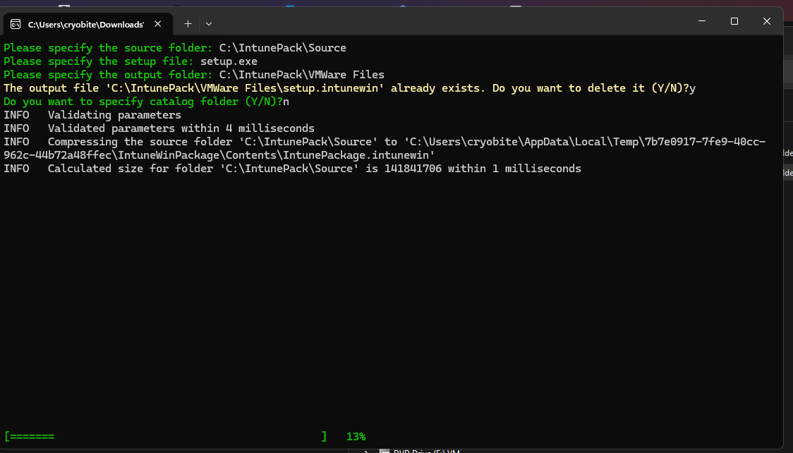
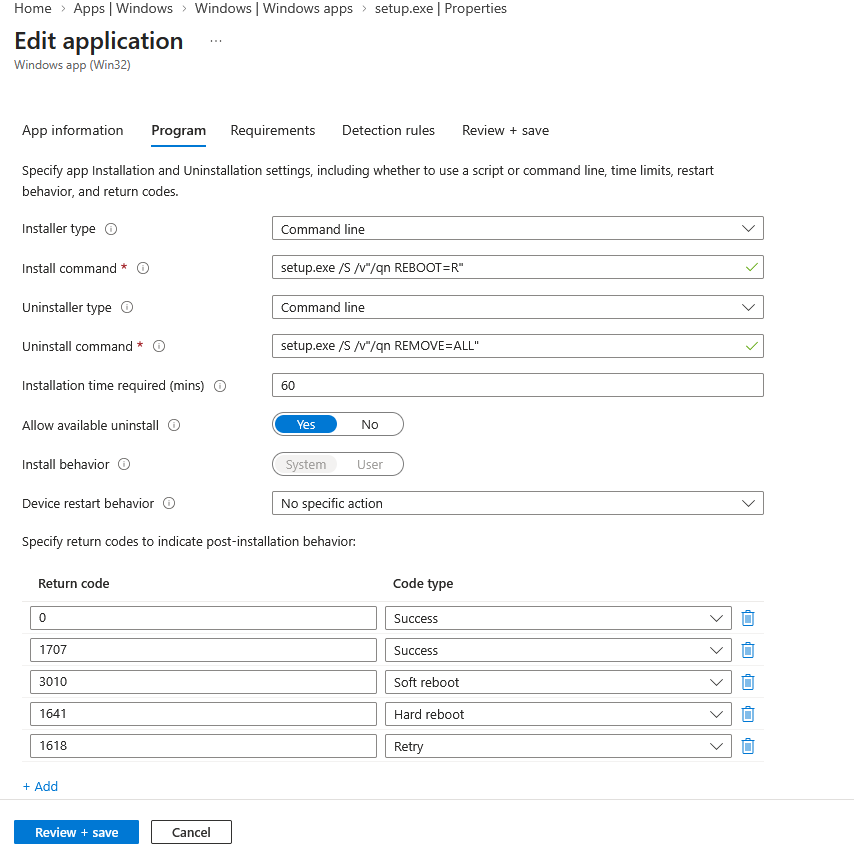
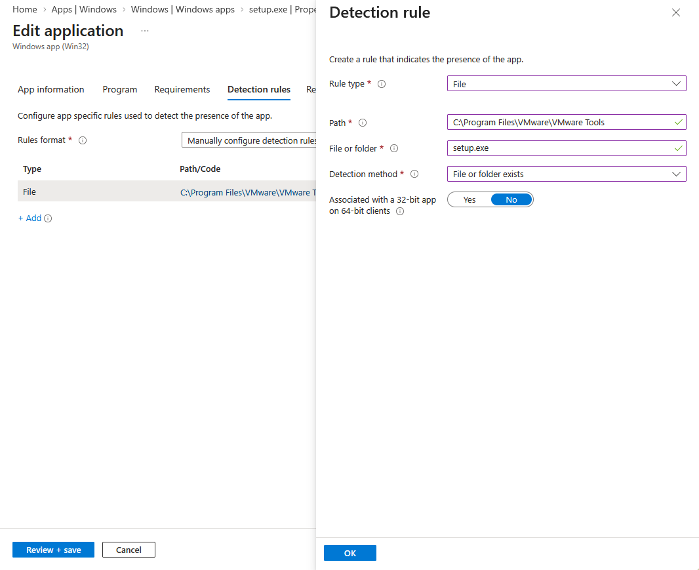
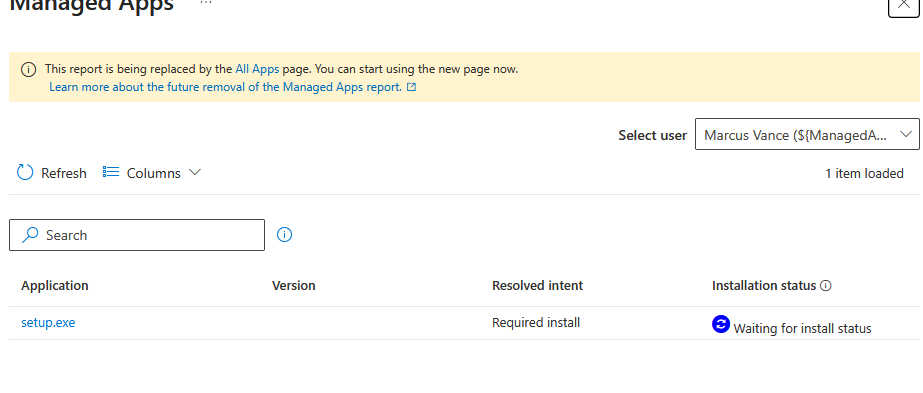
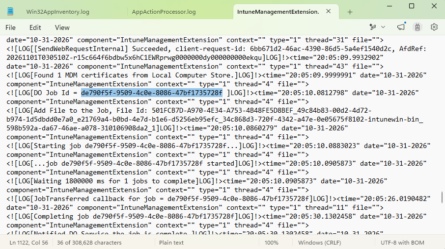

# Silently Deploying a Win32 App via Microsoft Intune (Bypassing UAC)

## 📌 Project Overview
In a corporate environment, standard users should not be prompted for Global Admin credentials to install required software. This project demonstrates how to package a legacy installer (VMware Tools) into an `.intunewin` file and deploy it silently to an Entra-joined Windows 11 VM using Microsoft Intune, bypassing the User Account Control (UAC) prompt by executing in the `System` context.

## 🏗️ Lab Environment
* **Cloud Environment:** Microsoft 365 Business Premium Trial (Entra ID P1 + Intune)
* **Client Device:** Windows 11 Pro (Virtual Machine)
* **Deployment Tool:** Microsoft Win32 Content Prep Tool (`IntuneWinAppUtil.exe`)
* **Application:** VMware Tools (`windows.iso`)

## 🚀 Execution Steps

### 1. Extracting and Packaging the Installer
Instead of copying the installer from inside the VM, the raw ISO was mounted directly on the host machine.
* Copied `setup.exe` and the supporting `Program Files` directory into a staging folder (`C:\IntunePack\Source`).
* Ran the **Win32 Content Prep Tool** to recursively compress the directory into a deployable package.

```cmd
IntuneWinAppUtil.exe -c C:\IntunePack\Source -s setup.exe -o C:\IntunePack\Output
```



### 2. Configuring the Intune Win32 App
Uploaded the generated `setup.intunewin` file to the Microsoft Intune admin center and configured the silent execution parameters.

**Program Settings:**
* **Install command:** `setup.exe /S /v"/qn REBOOT=R"`
  * `/S`: Suppresses the InstallShield wrapper UI.
  * `/v"/qn REBOOT=R"`: Passes quiet mode and reboot suppression commands directly to the underlying MSI.
* **Uninstall command:** `setup.exe /S /v"/qn REMOVE=ALL"`
* **Install behavior:** `System` *(Crucial step: This ensures the Intune Management Extension installs the app using the high-privilege SYSTEM account, completely bypassing UAC prompts for standard users).*



### 3. Creating the Detection Rule
To ensure Intune can verify the installation success without relying on fluctuating MSI product codes, a **File-based detection rule** was created to check for the presence of the primary service executable.
* **Path:** `C:\Program Files\VMware\VMware Tools`
* **File or folder:** `vmtoolsd.exe`
* **Detection method:** File or folder exists



### 4. Deployment and Verification
* Assigned the application as **Required** to the `SG-Intune-Pilot-Users` security group.
* To bypass the standard Intune polling interval, forced a manual sync from the Windows 11 VM (`Settings > Accounts > Access work or school > Info > Sync`).
* Verified background execution by monitoring `msiexec.exe` in Task Manager and checking the `IntuneManagementExtension.log`.
* **Result:** VMware Tools installed silently in the background, successfully enabling clipboard sharing and drag-and-drop between the host and the VM without any user interaction.


<br>

